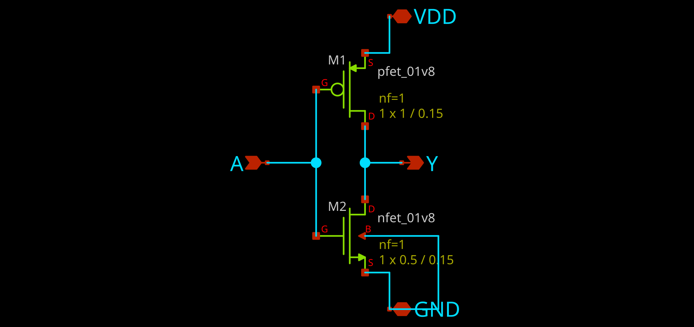
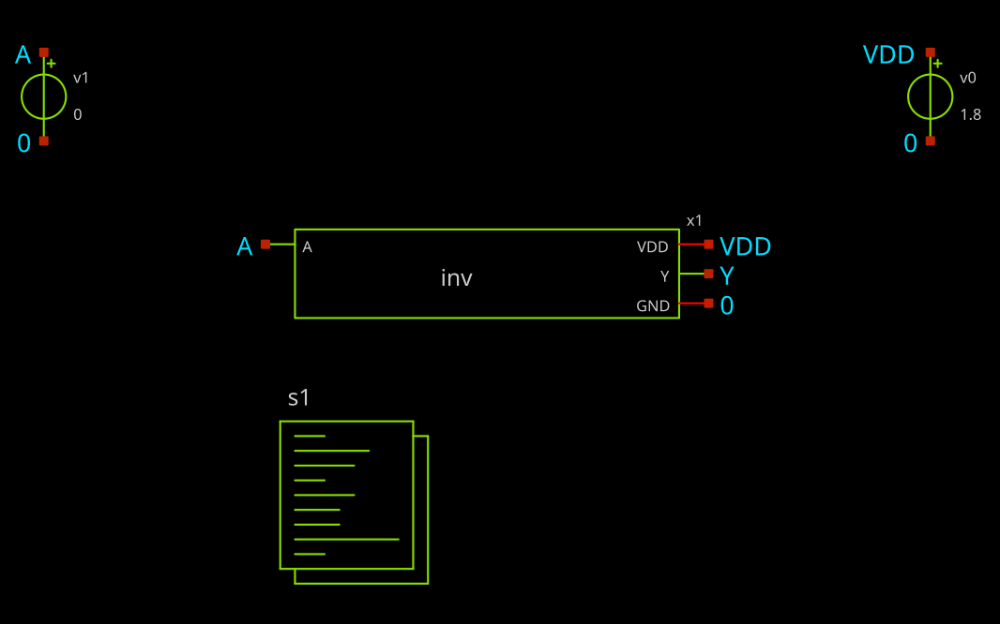
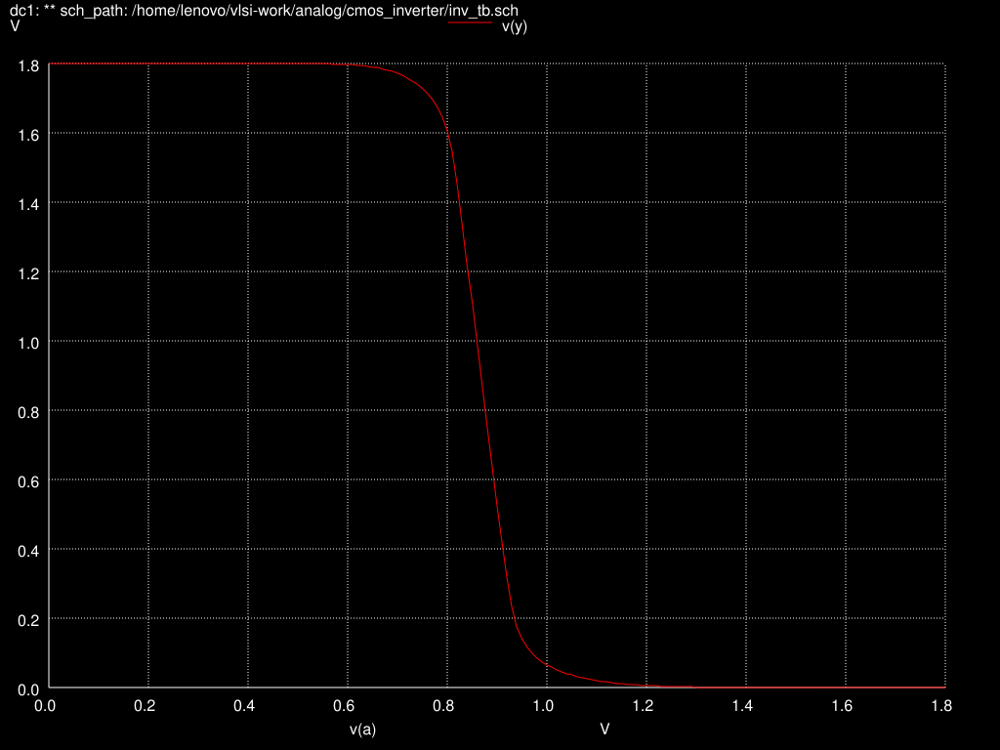
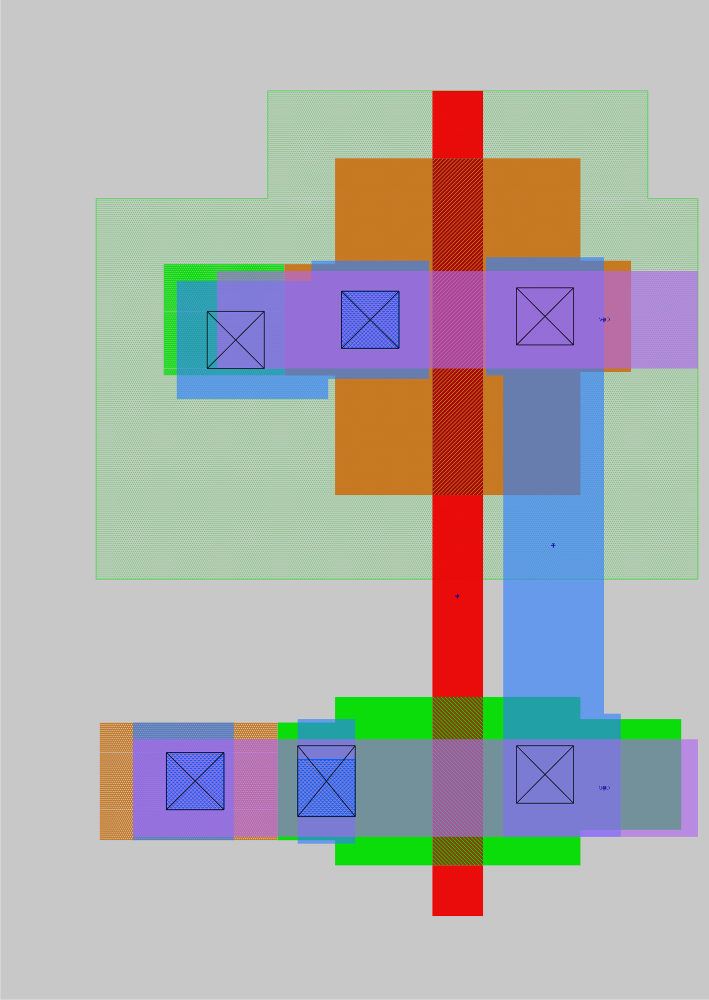

# CMOS Inverter — Full-Custom Design on SkyWater SKY130

A complete full-custom design of a CMOS inverter in the open-source **SkyWater SKY130** 130 nm process, taken from schematic to a hand-drawn, verified layout using only open-source tools.

**schematic → simulation → layout → DRC → extraction → LVS**

## Results at a glance

| Check | Result |
|---|---|
| Switching threshold (Vm) | **0.870 V** at VDD = 1.8 V (TT corner, 27 °C) |
| DRC (Magic, sky130A rules) | **0 errors** |
| LVS (Netgen) | **Circuits match uniquely** (2 devices, 4 nets) |
| Device sizes | PMOS W/L = 1 / 0.15 µm, NMOS W/L = 0.5 / 0.15 µm |

## 1. Schematic



Two transistors share one input **A**. When A is low, the PMOS (M1) turns on and pulls the output **Y** up to VDD. When A is high, the NMOS (M2) turns on and pulls Y down to GND.

The cell is a clean subcircuit with four pins (VDD, GND, A, Y) and no sources inside it. A symbol (`inv.sym`) was generated from it, so it can be placed like any other component.

## 2. Testbench and DC simulation



The testbench places the inverter symbol between a 1.8 V supply (v0) and an input source (v1) that sweeps from 0 to 1.8 V in 10 mV steps. Simulated in **ngspice** with the SKY130 `tt` models.



The output stays at 1.8 V while the input is low, falls sharply around 0.87 V, and settles at 0 V. The switching threshold, measured with `meas dc vm when v(y)=v(a)`, is **Vm = 0.8697 V**.

Vm sits slightly below VDD/2 (0.9 V). Electrons move about 2–3× faster than holes, so the NMOS is still the stronger device even though the PMOS is twice as wide.

## 3. Layout



The layout was drawn by hand in **Magic**, layer by layer:

- **PMOS** inside an **N-well**, with an N-well tap tying the well to VDD
- **NMOS** on the P-substrate, with a **P-substrate tap** tying the substrate to GND
- A shared **poly gate** forms input A
- The drains are joined in **local interconnect (li1)** to form output Y
- **metal1** rails for VDD (top) and GND (bottom), connected through vias

## 4. DRC — Design Rule Check

Checked against the full sky130A rule deck in Magic:

```
DRC_ERROR_COUNT: 0
```

Log: [`verification/inv_drc.log`](verification/inv_drc.log)

## 5. Extraction

The layout was extracted back into a SPICE netlist (`extract all`, `ext2spice lvs`):

```
.subckt inv_layout VDD GND A Y
X0 Y A VDD VDD sky130_fd_pr__pfet_01v8 ... w=1 l=0.15
X1 Y A GND GND sky130_fd_pr__nfet_01v8 ... w=0.5 l=0.15
```

The body terminals come out as **VDD** and **GND**. That shows both well taps are connected correctly.

## 6. LVS — Layout vs. Schematic

Compared with **Netgen** using the sky130A setup file:

```
Final result: Circuits match uniquely.
```

Device count, net count, connectivity and W/L all match, with no property errors. Report: [`verification/inv_lvs.out`](verification/inv_lvs.out)

## Repository structure

```
schematic/     inv.sch (cell), inv.sym (symbol), inv_tb.sch (testbench)
simulation/    inv_tb.spice (testbench netlist)
layout/        inv_layout.mag (Magic layout), export_layout.tcl (DRC + image script)
verification/  inv_layout.spice, inv_sch.spice, inv_lvs.out, inv_drc.log
images/        schematic, testbench, VTC and layout images
```

## How to reproduce

Requires the sky130A PDK (installed here with volare) and `$PDK_ROOT` set.
Update the `.lib` path in the testbench to match your PDK install.

```bash
# Simulation
ngspice simulation/inv_tb.spice

# DRC + layout image (run inside layout/)
magic -d XR -noconsole -rcfile $PDK_ROOT/sky130A/libs.tech/magic/sky130A.magicrc export_layout.tcl

# LVS (run inside verification/)
netgen -batch lvs "inv_layout.spice inv_layout" "inv_sch.spice inv" \
  $PDK_ROOT/sky130A/libs.tech/netgen/sky130A_setup.tcl inv_lvs.out
```

## Tools

| Step | Tool |
|---|---|
| Schematic + netlist | Xschem |
| Simulation | ngspice |
| Layout, DRC, extraction | Magic |
| LVS | Netgen |
| Process | SkyWater SKY130 (sky130A) |

## What I learned

- **Taps matter.** The first P-substrate tap kept failing contact-spacing rules. Widening the tap to give every rule deliberate margin fixed it cleanly, without squeezing the contact in.
- **Measure, don't guess.** When a metal1 shape didn't land where expected, checking the actual layers in that area (`select area` + `what`) found the problem faster than repainting.
- **Verify what's on disk.** A check of the saved layout file showed the VDD rail had been lost during an earlier reset. It was rebuilt before extraction.
- **Separate the cell from the testbench.** LVS needs a clean subcircuit, so the original combined schematic was split into the cell and a separate testbench. The simulation was rerun through the symbol to confirm nothing changed.
